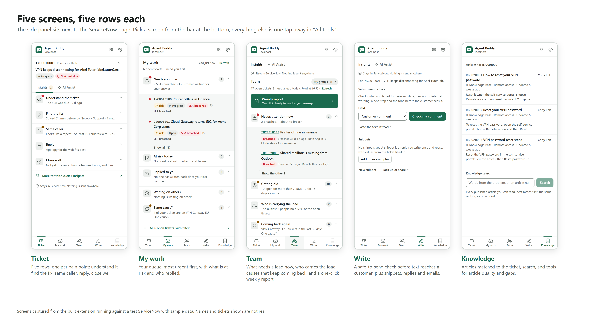
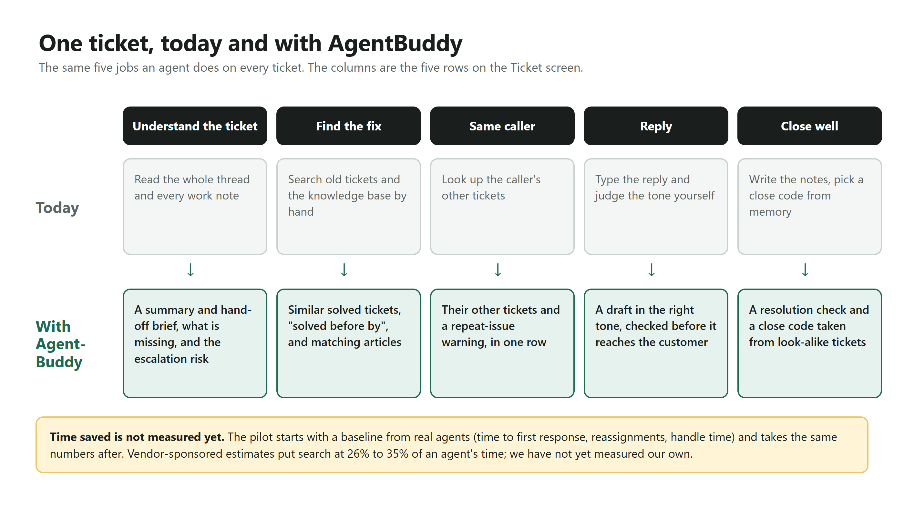
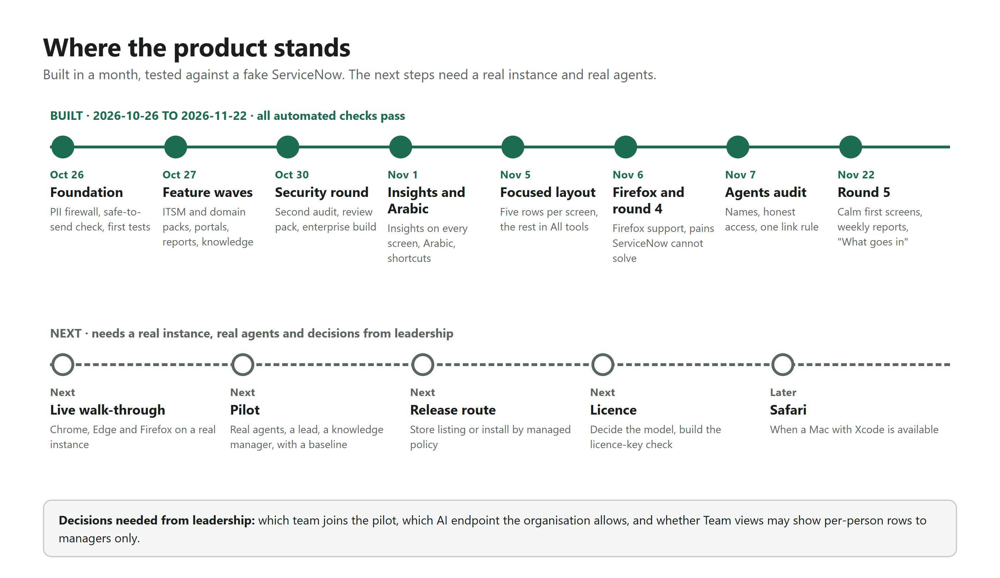
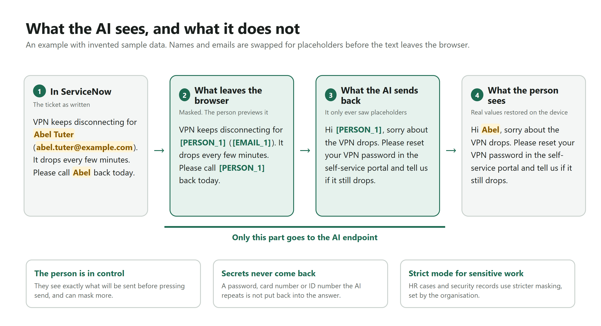
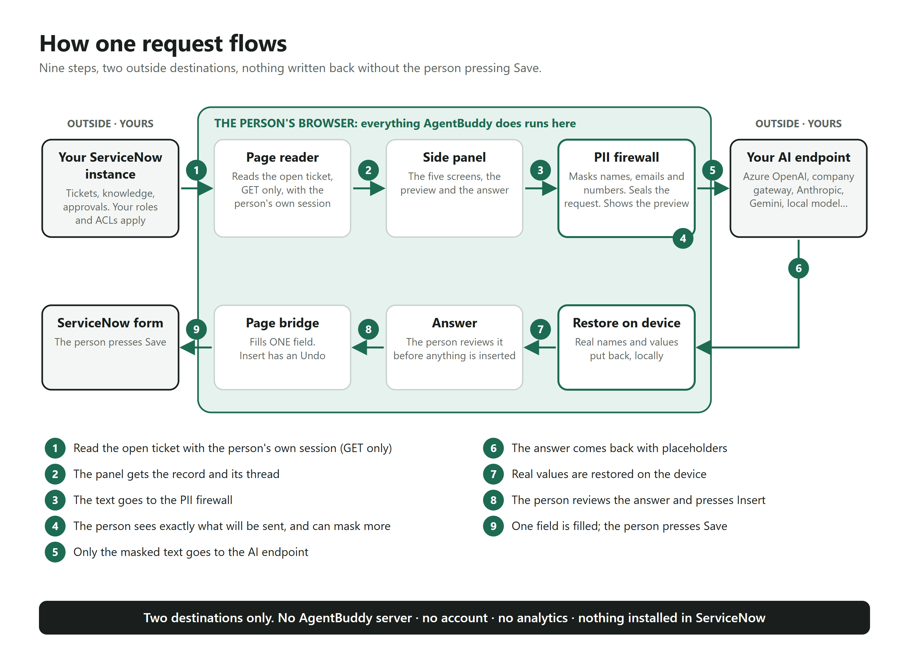
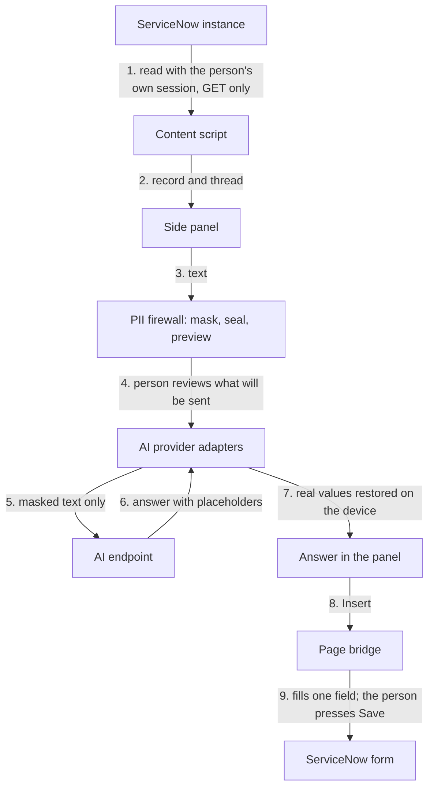

# AgentBuddy: AI Task Page

Nov 25, 2026

> Pictures are in `images/` (five PNG files, numbered in the order they appear). To put them in Confluence, upload each PNG to the page. Repo copy of the Confluence page, laid out in the AI task template (Summary, Current Process / Pain Point, Proposed AI Solution, Target Users, Expected Business Value, Milestones, AI / Technology Approach, Data & Knowledge Sources, Integrations / Dependencies, Security & Data Classification, Architecture / Flow, Achieved). Written from the code and the docs, not from a live instance. Anything marked "not verified" has passed the automated tests against a fake ServiceNow but has not been checked on a real instance. The full feature guide is in the five files listed at the end.

## AI Task Name

AgentBuddy: an AI assistant for ServiceNow fulfillers and team leads (browser extension)

## Summary

AgentBuddy is a browser extension that helps ServiceNow fulfillers and their team leads work tickets faster. It reads the ticket the person already has open, hides personal data, asks an AI model the organisation chose, and fills the answer into the form for the person to review and save. It needs no admin role, no ServiceNow plugin, no extra ServiceNow licence, and no server of ours.

| Fact | Value |
| --- | --- |
| Version | 0.1.0, built on 2026-11-22 (round 5) |
| Browsers | Chrome and Edge (one package), Firefox 128 or later; Safari planned |
| Works on | ServiceNow classic UI, Workspaces, Service Portal, Employee Center, customer service and HR portals |
| Record kinds | Incident, problem, change, request and requested item, catalog task, customer case, HR case |
| Languages | English and Arabic (right to left), 3,533 Arabic texts |

The promise in one line: nothing is written to ServiceNow by the extension, personal data is masked before any AI call, and the only places data goes are the organisation's own ServiceNow and its own AI endpoint.

## Current Process / Pain Point

Agents lose time reading long threads, hunting for earlier fixes, typing replies and writing close notes. Team leads cannot see queue health without building reports. ServiceNow's own AI summaries sit in the Pro Plus tiers, which many organisations do not license.

| Role | Biggest pains AgentBuddy answers |
| --- | --- |
| Service desk agent (L1) | Logging tickets fast, finding the fix, writing replies |
| Resolver (L2, L3) | Tickets with missing facts, long threads, "has this happened before?" |
| Catalog fulfiller | Reading variables, "what was fulfilled before", chasing blocked approvals |
| Customer service agent | No account context, cases bounced by engineering |
| HR case agent | Confidential data, policy-correct wording |
| Team lead | Queue health without building reports, stale tickets, hand-overs |
| Knowledge owner | Duplicate and stale articles, not knowing what to write next |
| Major incident and change roles | Updates every 30 minutes, CAB preparation, linking to a problem |

What the research says: wrong first assignment can add up to 10 times to triage time (Microsoft study, ICSE 2019). Agents spend 26% to 35% of their time searching for information across systems, and after-contact work is 6% to 25% of handle time (vendor-sponsored estimates). These are published industry figures, not measurements from our own pilot.

## Proposed AI Solution

A side panel next to the ServiceNow page, with five screens chosen from an icon bar at the bottom. Each screen shows five rows; everything else is one step away in an "All tools" button. Checks and lists run without AI; the AI actions come after a preview of exactly what will be sent.

| Screen | What it gives the person |
| --- | --- |
| **Ticket** | Five rows, one per pain point: **understand the ticket** (summary, hand-off brief, missing information, sentiment and escalation risk, thread summary), **find the fix** (similar solved tickets, knowledge matches, error codes, "solved before by"), **the same caller** (their other tickets, repeat-issue warning, caller's language, "Brief me on this caller"), **reply** (draft, tone and next-step checks, translate the caller's message), **close well** (resolution check, close code from look-alikes, "Prepare to close") |
| **My work** | Your queue, most urgent first, with an "At risk" chip; "My week" summary of what you handled |
| **Team** | Needs-attention-now first, then overview, SLA radar, fulfilment, workload and quality dashboards; one-click **Weekly report** (PDF, CSV or copy); report builder, saved dashboards, shift hand-over, "explain this dashboard"; an opt-in coaching snapshot that is off unless the organisation switches it on |
| **Write** | Customer reply drafts, six email types, rewrite (shorter, friendlier, plain, formal, fix spelling, translate, bilingual), notes to a new ticket, personal snippets with variables, a **safe-to-send** check before text reaches a customer |
| **Knowledge** | Article from a ticket, article checks and optimise, duplicate finder with a merge draft, knowledge-gap radar, chat summary and chat reply suggestions |

Beyond the five screens:

- **Quick actions on the page.** A small icon bar at the bottom of the ServiceNow page starts the main actions with one click; the organisation can switch it off.
- **Keyboard shortcuts.** Alt+Shift+1 opens the panel, Alt+Shift+2 summarises, Alt+Shift+3 drafts a reply. Ctrl+K opens All tools.
- **"What goes in" before sending.** The person sees exactly what text goes to the AI and can mask more before pressing send.
- **Answer formats.** The person or the organisation chooses the sections, style and length of the summary, hand-off brief and catch-up, and can add extra instructions to any of 20 AI actions. Rules about facts, privacy and customers always stay on.
- **Domain packs.** Major-incident updates, problem statement and root-cause write-up, change and CAB brief, account briefing, case-to-engineering escalation, HR case brief.
- **Insert with Undo.** "Insert" fills one field on the open form and offers Undo; the person still presses Save.
- **Arabic and right-to-left layout**, dark mode, and a layout that works down to 320 px wide.

## Target Users

Built for people who work tickets every day with normal roles, not for ServiceNow developers or admins. The rule for every feature was: would an agent or team lead reach for this daily without admin rights?

Primary users: service desk agents (L1), resolvers (L2, L3), catalog fulfillers, customer service agents, HR case agents, and team leads. Secondary users: knowledge owners, and major incident and change roles.

Where the value is highest: teams with no ServiceNow AI licence, teams in regulated settings (the security and privacy review is easy because of the design below), and teams that work in Arabic or mixed-language queues. It is least needed where an organisation already has Now Assist everywhere and is happy with it.

## Expected Business Value

| Value | How |
| --- | --- |
| Faster handling | Less time reading long threads, searching for earlier fixes, typing replies and writing close notes |
| Better first assignment and fewer reassignments | Missing-information check and look-alike tickets before the ticket moves |
| Consistent quality | Resolution check, close code from look-alikes, safe-to-send check, answer formats set by the organisation |
| Queue visibility for leads | Needs-attention-now list, SLA radar, one-click weekly report, shift hand-over, without building reports |
| Lower cost and risk | No ServiceNow AI licence tier, no plugin, no server to run or approve; the organisation pays only its own AI usage |
| Works in more places | Arabic and right-to-left, Chrome, Edge and Firefox |

Measured impact: not yet. The figures quoted above are industry numbers. The first step of a pilot is a baseline from real agents (time to first response, reassignments, handle time), then the same numbers after.

## Milestones

| Date | Milestone |
| --- | --- |
| 2026-10-26 | Foundation: PII firewall, safe-to-send check, Related tab, first tests (448 passing) |
| 2026-10-27 | Feature waves: ITSM and domain packs, portals, Write tools, knowledge and chat, reports and dashboards, DeepSeek added; real-Chrome end-to-end harness |
| 2026-10-30 | Round 2: second independent security audit, review pack for the security team, enterprise build, quick-actions bar |
| 2026-11-01 | Round 3: Insights and AI Assist on every screen, work profiles, Arabic and right-to-left, shortcuts, self-hosted install, minified build, accessibility and dark-mode audit |
| 2026-11-05 | Focused layout: screens in a bottom bar, five rows per screen, every option in "All tools" |
| 2026-11-06 | Firefox support; round 4 "Loved": the pain points ServiceNow cannot solve, inside the five rows |
| 2026-11-07 | Agents-and-fulfillers audit built: display names, honest access messages, one link rule, panel only on added sites |
| 2026-11-22 | Round 5: calm first screens, weekly reports, "What goes in" before sending, lighter page script |
| 2026-11-24 | Leadership guide written |

Next:

1. Walk the product on the real instance in Chrome, Edge and Firefox and close the open live questions.
2. Run a pilot with real fulfillers, a team lead and a knowledge manager; take baseline numbers before and after.
3. Decide how to release: a store listing or a self-hosted install by managed policy.
4. Decide the licence model and build the licence-key check.
5. Safari, once a Mac with Xcode is available.

Decisions to take with leadership: which team joins the pilot, which AI endpoint the organisation will allow, and whether Team views may show per-person rows to managers only.

## AI / Technology Approach

AgentBuddy is plain JavaScript and React 18 packaged as a Manifest V3 browser extension. It has no backend, no account and no analytics: everything runs in the person's browser.

| Layer | Technology |
| --- | --- |
| Platform | Manifest V3 extension. Chrome 116+ and Edge share one package and use the browser's side panel. Firefox 128+ has its own package and uses its sidebar. One source tree; one small module (`platform.js`) knows how the browsers differ |
| User interface | React 18.3.1 and ReactDOM, the only two runtime dependencies. Side panel, settings page and a full-page dashboard, with shared colour tokens |
| Code | JavaScript with JSX, about 525 source files and 75,000 lines, split by area: PII firewall, AI providers, reads from ServiceNow, features and packs, reports, policy |
| Build | Node 22.12+ and esbuild 0.23. Reproducible builds (the same source gives byte-identical files, checked by SHA-256), minified for release, with a software bill of materials in CycloneDX format |
| AI | Any key: adapters for OpenAI-style APIs (Azure OpenAI, OpenAI, company gateways, Gemini, Mistral, Groq, DeepSeek, OpenRouter, local Ollama) and for Anthropic. The AI key is kept in the browser, in a vault, in memory only, or encrypted with a passphrase, as the organisation allows |
| How the AI is used | Prompts are built from the masked ticket text and an answer format. Rules about facts, privacy and customers always stay on. The answer comes back with placeholders; real values are restored on the device. The person reviews before anything is inserted |
| Administration | Browser managed policy (Chrome and Edge schema, Windows registry, macOS profile, Google admin console, Firefox policies) can pin the AI provider and address, lock features and formats, and switch the on-page bar off. An enterprise build can compile one organisation's hosts and policy in |

## Data & Knowledge Sources

| Source | What is read | How |
| --- | --- | --- |
| The open ticket | Fields and thread (comments, work notes) of the record on screen | A small bridge inside the ServiceNow page reads form values |
| ServiceNow tables | Similar solved tickets, the same caller's other tickets, knowledge articles, approvals, SLAs, queue and team data | GET-only calls to ServiceNow's own table API using the person's signed-in session, so their roles and ACLs apply. A refused read says so; it is never shown as "none" |
| Knowledge base | The organisation's own articles, for matches, article checks, duplicates and gaps | Same table API |
| The person's own settings | Answer formats, snippets, saved dashboards, language | Stored in the browser |
| Organisation policy | AI endpoint, blocked tables and fields, switched-off features | Browser managed policy |

No outside knowledge base, no training on the organisation's data, no copy of ticket data kept by us. The local audit log keeps no ticket content.

## Integrations / Dependencies

| Dependency | Role |
| --- | --- |
| The organisation's ServiceNow instance | The only source of data; read-only, through the person's own session |
| An AI endpoint the organisation chooses | The only other network destination. Azure OpenAI, OpenAI or a company gateway, Anthropic, Gemini, Mistral, Groq, DeepSeek, OpenRouter, or a local model (Ollama) |
| Chrome 116+, Edge, Firefox 128+ | Host browsers. Firefox release also needs Mozilla signing |
| Browser managed policy (optional) | Pins settings for the organisation |
| React 18.3.1 and ReactDOM | The only runtime dependencies |

Not needed: a ServiceNow plugin, update set, scoped app, admin role, extra ServiceNow licence, or any server of ours.

## Security & Data Classification

The design starts from the question a security reviewer asks, and answers it with the architecture rather than with promises. Controls are tied to automated tests in a traceability matrix; anything not yet checked on a real instance is marked as unverified in the security notes.

- **Read-only.** The extension never writes to ServiceNow. "Insert" fills one field on the open form and the person presses Save.
- **Their own access.** Reads use the person's signed-in session, so ServiceNow's roles and ACLs decide what is visible.
- **Masking before the AI.** The record's people, and names the surrounding words mark in the text, are replaced with placeholders. The person sees exactly what will be sent and can mask more. Passwords, card numbers and ID numbers never come back into an answer.
- **No server of ours.** No vendor server, account or analytics. The only destinations are the organisation's ServiceNow and its AI endpoint. The masked text does go to the AI vendor's servers, so the choice of endpoint is the main decision for a security team (an internal gateway, an Azure resource or a local model keep it in the organisation's control).
- **Small permissions.** Access to a ServiceNow or AI address is requested one host at a time. The extension does not ask for tabs, history, cookies, web requests or downloads, and its page security policy allows no remote or inline scripts.
- **Sensitive data by default.** HR cases use a strict privacy mode gated by policy; security incident, vulnerability and GRC tables are treated as sensitive.
- **Organisation control.** Managed policy can pin the AI provider, address and models, choose where the key is stored, lock or publish answer formats, block tables and fields, and switch features off.

| Data | Classification handling |
| --- | --- |
| Ticket text | Masked before it leaves the browser; preview before sending |
| HR case free text | Never sent unless policy allows it |
| Security, vulnerability, GRC tables | Treated like HR |
| AI key | In the browser only (vault, memory, or passphrase-encrypted) |
| Audit log | Local, no ticket content |

Review pack for the security team: security notes with known limits, data-flow diagram, STRIDE threat table, control-to-test traceability matrix, a filled data protection impact assessment template, sample policies for each browser, and the bill of materials. Two independent security audits have been run on the code.

Licensing and price (a proposal, not yet decided): the code of a browser extension cannot be hidden from the machine it runs on, so protection would come from a licence contract, a signed licence key tied to the instance and an expiry date, and continuing updates. Because there is no backend, seats cannot be metered; the proposed model is an annual fee per ServiceNow instance, banded by agent count, plus a paid pilot and a setup fee. The customer pays their own AI usage.

## Architecture / Flow

One request, step by step: 9 steps, 2 outside destinations (the organisation's own ServiceNow and its own AI endpoint).

The same flow as editable text (GitHub draws this; Confluence needs a Mermaid macro, so use the picture above there):

Read the ticket with the person's own session, mask it, send only the masked text to the AI, restore the real values on the device, and fill one field; the person reviews and saves.

## Achieved

The product is built through round 5 (2026-11-22) and passes all automated checks. It has been seen in part on a real ServiceNow instance, but it has not yet been piloted with real agents, so the time savings are not yet measured.

| Area | State |
| --- | --- |
| Features on the five screens | Built and tested against a fake ServiceNow |
| Quality checks | On 2026-11-22: 4,302 unit tests, 1,318 end-to-end checks each in real Chrome and Edge against a fake ServiceNow, 61 in Firefox, 0 failed; lint, compile check, control-to-test traceability and an Arabic completeness check run before every commit |
| Security | Two independent audits run; review pack ready for the security team |
| Chrome | Seen in part on a developer instance; more live checks open |
| Edge | Same package as Chrome; automated run passes, hand checks on a real instance open |
| Firefox | Automated run in real Firefox passes; not yet checked on a real instance |
| Safari | Not supported; planned once a Mac is available |
| Store release | Not published to any store; installed as an unpacked build or by managed policy |
| Measured impact | Not yet; a baseline from real agents is the first step of a pilot |

## The full guide

[Getting started](01-getting-started.md) to install and set up, [Ticket screen](02-ticket-screen.md) for every Insights card and AI action, [My work and Team](03-my-work-and-team.md) for the queue and the lead dashboards, [Write and Knowledge](04-write-and-knowledge.md) for replies, emails, snippets and the knowledge tools, and [Settings and admin](05-settings-and-admin.md) for settings, privacy, administrator policy and troubleshooting.
